<div align="center">
  
</div>

<br/>

```text
root@el3ch:~$ cat /etc/whoami.txt
```

Software Engineering student at **ESPRIT** (Tunis, Tunisia) passionate about **systems programming**, **offline-first architectures**, and **intelligent software**. I bridge low-level engineering (**C**, **Win32 API**, **Linux**) with modern product development (**Flutter**, **Supabase**, **SQLite**, **Python**).

Rather than just learning syntax, I focus on building resilient software from the ground up.

<div align="center">
  
</div>

### `> ls -la ~/flagship_projects/`

#### 01. **SynkroTask** — Offline-First Task Architecture `Aug 2026 – Oct 2026`
`Flutter` · `Supabase` · `SQLite` · `PostgreSQL`
- Cross-platform task management built on a production-grade **offline-first architecture**.
- Engineered a local **SQLite** cache with an atomic pending-writes queue and bidirectional background delta synchronization against **Supabase**.
- Hardened multi-tenant privacy with **PostgreSQL Row-Level Security (RLS)** policies, `SECURITY DEFINER` RPCs, client-side session invalidation, and atomic cache purging to eliminate cross-account data leakage.
- Validated reliability through **40+ automated unit & integration tests** and released native Android builds ([`SynkroTask-downloads`](https://github.com/el3ch/SynkroTask-downloads)).

#### 02. **PulseForge** — High-Precision Windows Utility `Jun 2026 – Jul 2026`
`Python` · `Win32 API` · `CustomTkinter`
- High-performance, sub-millisecond Windows input automation utility for precision peripherals.
- Interfaced with native Windows OS subsystems via low-level hooks (`WH_MOUSE_LL`, `WH_KEYBOARD_LL`) and `timeBeginPeriod(1)` multimedia timer resolution for stable **1–60 CPS** execution with zero CPU drift.
- Built hardware burst-fire detection calibrated for multi-button gaming mice, global emergency kill-switch (`F12`), system tray minimization, and Defender-safe packaging.

#### 03. **CyberPunks** — 2D Matrix Combat Engine `Feb 2025 – Jun 2026` · *ESPRIT*
`C` · `SDL2` · `Linux`
- Designed and implemented a 2-player 2D fighting game in pure **C** using **SDL2** without external game engines.
- Built a custom game loop, combat state machines, sprite-sheet animation systems, and bounding-box collision detection.
- Managed dynamic memory allocation and resource cleanup to guarantee zero memory leaks.

<div align="center">
  
</div>

### `> cat /var/log/education_and_credentials.log`

| Timeline | Node | Details |
| :--- | :--- | :--- |
| **Sep 2025 – May 2030** | **ESPRIT** | Engineer's Degree, IT (`Software Engineering`) |
| **Active** | **IEEE Student Member** | Exploring **LLMs**, **Prompt Engineering**, and **RAG** |
| **Certified** | **Neuro-Linguistic Programming (NLP)** | International **Level 4 Certification** — analytical & communication mastery |

<div align="center">
  
</div>

### `> ./list_arsenal.sh`

**Languages**  


**Frameworks & Engines**  


**Data & Backend**  


**Systems & Architecture**  


<div align="center">
  
</div>

### `> ./establish_uplink.sh`

Always open to discussing **software engineering**, **systems design**, and **internship opportunities**.

<p align="left">
  <a href="https://www.linkedin.com/in/mohamed-amine-el-euch-86b294321/">
    
  </a>
  <a href="mailto:mohamedamine.eleuch@gmail.com">
    
  </a>
  <a href="https://github.com/el3ch">
    
  </a>
</p>

<div align="center">
  <sub><code>&gt; "There is no spoon. Only clean architecture."</code></sub>
</div>
